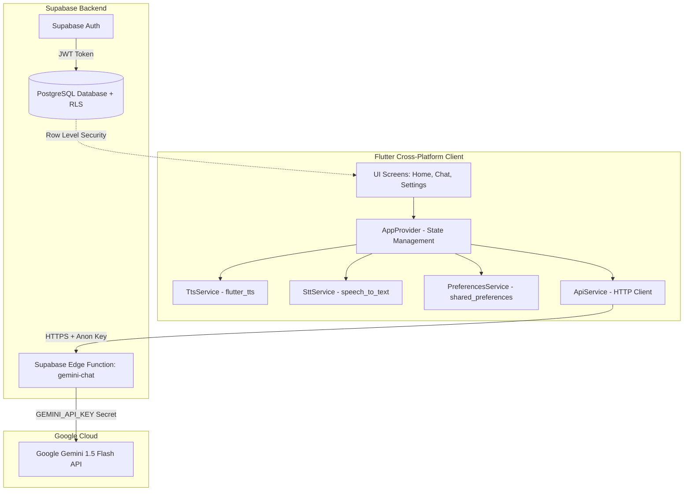
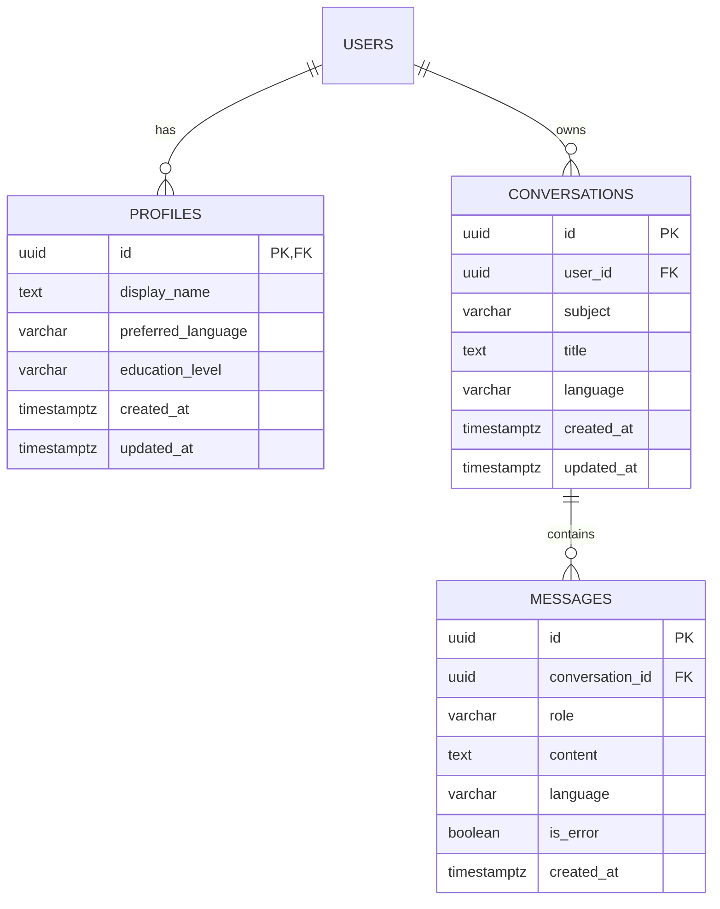

# AI Tutor Architecture & System Design

This document details the architectural design, component layers, data flows, and security model implemented in **AI Tutor Phase 1**.

---

## 🏛️ High-Level System Architecture



---

## 📂 Directory Structure

```
d:\Tutor\
├── lib/
│   ├── main.dart                      # App entry point & RTL Directionality wrapper
│   ├── models/
│   │   ├── message.dart               # Message model (UUID, role, content, timestamp)
│   │   ├── subject.dart               # 6 subjects with trilingual translations
│   │   └── education_level.dart       # 5 education levels with pedagogical prompts
│   ├── providers/
│   │   └── app_provider.dart          # Central state: chat, language, education level, TTS
│   ├── screens/
│   │   ├── home_screen.dart           # Home dashboard, hero banner, subject grid
│   │   ├── chat_screen.dart           # Chat interface with Markdown, TTS, & STT
│   │   └── settings_screen.dart       # Language, education level, and Supabase config
│   ├── services/
│   │   ├── api_service.dart           # Secure Edge Function caller & Demo mode fallback
│   │   ├── tts_service.dart           # Text-to-Speech audio output engine
│   │   ├── stt_service.dart           # Speech-to-Text microphone input engine
│   │   └── preferences_service.dart   # SharedPreferences persistence layer
│   └── theme/
│       └── app_theme.dart             # Material 3 light theme (Blue + Mint + White)
├── supabase/
│   ├── functions/
│   │   └── gemini-chat/
│   │       └── index.ts               # Deno Edge Function proxying Gemini with prompt injection
│   ├── migrations/
│   │   └── 20261109000000_init_schema.sql # PostgreSQL schema with Row Level Security (RLS)
│   └── config.toml                    # Supabase CLI project configuration
├── test/
│   └── widget_test.dart               # Unit & Widget tests (9 passed tests)
├── pubspec.yaml                       # Dependencies & Flutter project settings
└── README.md, ARCHITECTURE.md, SETUP.md, DEVIN_TASK.md
```

---

## 🧩 Core Architectural Decisions

### 1. State Management: Provider (`ChangeNotifier`)
- Clean, lightweight, and official Flutter standard.
- `AppProvider` maintains reactive states:
  - Selected language (`en`, `ur`, `ps`).
  - Active education level (`primary`, `middle`, `high`, `college`, `university`).
  - Chat message queue and loading states.
  - Backend configuration state (`isBackendConfigured`).
  - Speech playback active indicator (`isSpeaking`).

### 2. Localization & RTL Layout
- Automatic `Directionality` wrapping in `main.dart`:
  - When `languageCode == 'ur'` or `'ps'`, layout flips to `TextDirection.rtl`.
  - When `languageCode == 'en'`, layout is `TextDirection.ltr`.
- Central dictionary provides instant trilingual translations for all UI labels without heavy external bundle overhead.

### 3. Server-Side AI Gateway Pattern
- **Problem**: Storing API keys directly in the mobile/web app allows attackers to decompile the app and steal the key.
- **Solution**: The Flutter app communicates exclusively with the Supabase Edge Function (`/functions/v1/gemini-chat`) using standard project anonymous keys.
- The Edge Function reads `GEMINI_API_KEY` from its private server environment, validates request bounds (max 32KB payload, max 4000 char prompt), applies education level instructions, and invokes Gemini 1.5 Flash.

### 4. Offline & Demo Mode Fallback
- If the student has not yet configured Supabase credentials in the Settings screen, the app does not crash or throw unhandled exceptions.
- It seamlessly routes to `ApiService.sendDemoMessage()`, outputting a helpful, localized banner explaining how to connect their backend.

---

## 🗄️ Database Schema & RLS Policies



### Row Level Security (RLS) Guarantees
- **Profiles**: `auth.uid() = id`. A user cannot read or update other users' settings.
- **Conversations**: `auth.uid() = user_id`. Conversations are completely isolated between users.
- **Messages**: Checked via `EXISTS (SELECT 1 FROM conversations WHERE conversations.id = messages.conversation_id AND conversations.user_id = auth.uid())`. No user can eavesdrop on another user's tutor session.
